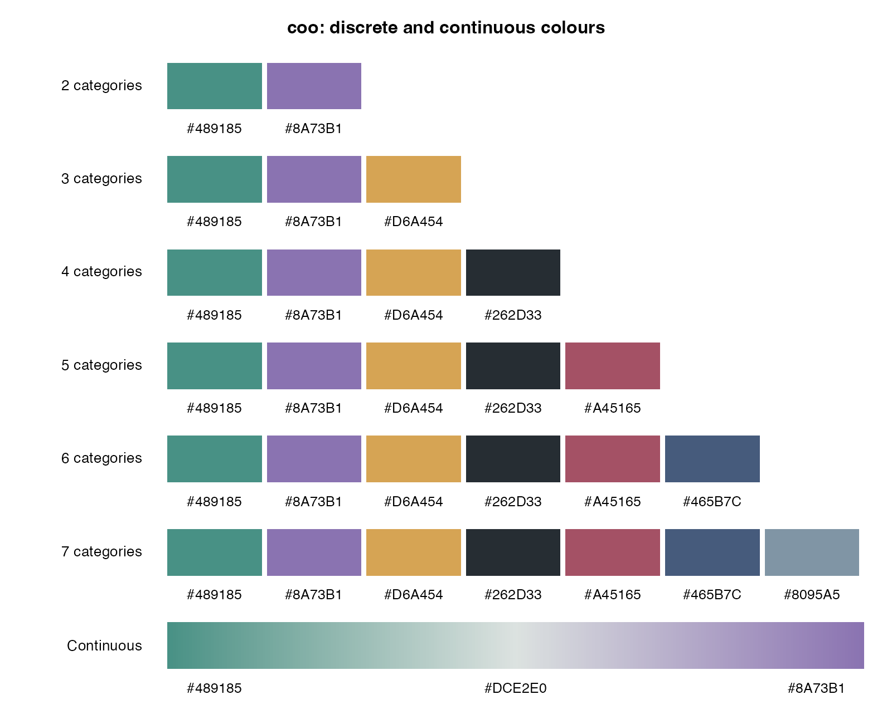

# coo

Pigeon-inspired colours for discrete and continuous data, in ggplot2 or other
plotting systems. The package provides one approved set of up to seven
categorical colours and one continuous feather-gray ramp.



## Installation

From this source directory, run:

```sh
R CMD INSTALL .
```

Or install a built source archive in R:

```r
install.packages("coo_0.1.0.tar.gz", repos = NULL, type = "source")
```

## ggplot2

The same scale automatically handles categories and continuous measurements:

```r
library(coo)
library(ggplot2)

ggplot(mtcars, aes(wt, mpg, colour = factor(cyl))) +
  geom_point(size = 3) +
  scale_color_coo()

ggplot(mtcars, aes(wt, mpg, colour = hp)) +
  geom_point(size = 3) +
  scale_color_coo()

ggplot(mtcars, aes(factor(cyl), fill = factor(gear))) +
  geom_bar() +
  scale_fill_coo()
```

`scale_colour_coo()` is an alias for `scale_color_coo()`. Factors, character
vectors, and logical vectors are discrete. Numeric data, including integers,
are continuous even when there are only a few unique values. For numeric
category codes, use `factor()` or `type = "discrete"`.

## Palettes and direct mapping

```r
coo_palette(2)                      # teal and violet
coo_palette(6)                      # all categorical colours except feather gray
coo_palette(256, "continuous")      # samples along the feather-gray ramp

coo_colors(c("control", "treatment", "control"))
coo_colors(c(10, 20, 30))            # teal, pale feather gray, violet
coo_colors(c(1, 2, 1), type = "discrete")

plot(mtcars$wt, mtcars$mpg, col = coo_colors(mtcars$hp), pch = 19)
display_coo()
```

`coo_colours()` is an alias for `coo_colors()`. Direct mapping returns one
colour per input value and preserves input names.

Discrete palettes add colours in this fixed order:

| Position | Colour | Hex |
|---|---|---|
| 1 | Teal | `#489185` |
| 2 | Violet | `#8A73B1` |
| 3 | Amber | `#D6A454` |
| 4 | Charcoal | `#262D33` |
| 5 | Rose | `#A45165` |
| 6 | Slate blue | `#465B7C` |
| 7 | Feather gray | `#8095A5` |

One category uses teal. More than seven categories produces an error; colours
are never silently repeated. A zero-length palette or input gives an empty
colour vector. Missing observations use `na.value`, initially `"grey50"`,
and do not consume a categorical colour.

## Consistent mappings across plots

Use the same category order or named assignments for categorical subsets:

```r
coo_colors(c("treatment", "control"),
           limits = c("control", "treatment", "other"))

assignments <- c(control = "#489185", treatment = "#8A73B1")
coo_colors("treatment", values = assignments)
scale_color_coo(values = assignments)
```

Use the same numeric limits to compare continuous values across plots:

```r
coo_colors(c(15, 25), limits = c(10, 30))
scale_fill_coo(limits = c(10, 30))
```

## Continuous controls

The continuous ramp interpolates `#489185` through `#DCE2E0` to `#8A73B1`
in CIELAB space. It is independent of the seven-colour discrete palette.
The API exposes only discrete and continuous modes, without ColorBrewer
palette-family labels.

By default, the observed numeric range uses the full ramp, with pale gray
halfway between its limits. Constant numeric data map to the selected centre
colour. Standard
ggplot2 transformations apply before rescaling; with `transform = "log10"`,
the default centre is the geometric mean of the limits.

```r
scale_color_coo(reverse = TRUE)
scale_color_coo(mid_color = "#262D33") # wing charcoal at the centre
scale_fill_coo(midpoint = 0, limits = c(-10, 10))
scale_color_coo(transform = "log10")
scale_color_coo(na.value = "transparent")
scale_color_coo(limits = c(0, 100), oob = scales::squish)
```

Set `mid_color = "#262D33"` to run the continuous ramp through wing charcoal
instead of feather gray. This option works in the colour and fill scales,
`coo_colors()`, `coo_palette(type = "continuous")`, and `display_coo()`.
It selects the centre **colour**; `midpoint` separately selects the numeric
value mapped to that colour. The discrete palette is independent of this
setting.

An explicit `midpoint` is expressed in original data units and follows
`scales::rescale_mid()`: equal distances from the midpoint receive equal
progress along their respective halves of the ramp. With asymmetric limits,
the nearer endpoint uses only part of its half of the ramp. Out-of-bounds
values become missing by default; `scales::squish` instead clamps them.

## Colour vision

The palette was developed with normal-vision colour-distance comparisons and
red-green colour-vision simulations. It is not certified as universally
colourblind safe. In particular, feather gray and teal become closer under
some red-green deficiencies, and rose and slate blue can also become closer.
The seven-colour set has weaker separation than smaller subsets. Use labels,
shapes, or line types alongside colour when readers must distinguish groups.

RColorBrewer inspired the palette-selection and preview interface. The colours
and continuous ramp are specific to `coo`; RColorBrewer is not a dependency.

## PDF vignette

The short getting-started vignette uses `mtcars` throughout. Its editable
source is `vignettes/coo.Rmd`. Building the source package with `R CMD build .`
compiles the PDF and includes it, the R Markdown source, and extracted R code
in the package bundle. Rebuilding the vignette requires `knitr`, `rmarkdown`,
Pandoc, and a LaTeX installation. An ordinary install from the built archive
uses the included PDF.

After installation, open it with:

```r
vignette("coo", package = "coo")
```
